# orchestrate-all

<p align="center">
  
</p>

**Orchestra**: describe a coding task once. An AI orchestrator splits it across Claude Code, Codex and Antigravity
workers, and a plain-code conductor makes sure they never clash.

> **Status: early build (Phase 1, steps 1–9 of 15).** The plan checks, repository checks, worktree manager, tamper checks,
> scope check, acceptance runner, merging, finalize checks and run store exist; nothing runs agents yet.
> Everything else below describes the plan. Facts about vendor CLIs are still being verified. Progress is tracked
> in [docs/PLAN.md](docs/PLAN.md).

---

## Why

If you use several AI coding agents (Claude Code, Codex, Gemini), today you switch between their panels by hand and
wait on each one. With Orchestra you describe the task once, and an **orchestrator** model (Claude Code or Codex,
whichever you started from):

1. splits the task into subtasks;
2. assigns each subtask to an engine and model;
3. runs them in parallel, each in its own isolated git worktree;
4. checks the results and merges them.

You approve before anything touches your branch. Each engine runs on **your own subscription** for that vendor,
through the vendor's official CLI and your own login.

## The key idea: the referee is code, not a model

Orchestra separates two roles on purpose:

| Role | What it is | What it does |
|---|---|---|
| **Orchestrator** | An AI model (Claude Code or Codex) | Plans the split, picks engines and models, reviews results. Never edits project files during a run. |
| **Conductor** | Plain code, no AI | Validates the plan, isolates workers, enforces file ownership, merges, and asks you for approval. |

Every rule lives in the conductor, never in a prompt. Orchestra therefore behaves the same whichever model is
orchestrating, and no model can talk its way past a rule.

## Hard requirements

| # | Requirement | In practice |
|---|---|---|
| R1 | **No file clashes, ever** | Each task declares the files it owns. Two tasks may own overlapping files only if one runs after the other. The conductor enforces this when it validates the plan, after each worker and again at merge. |
| R2 | **Works from Claude Code and Codex** | Either can be the front door, with identical behaviour. |
| R3 | **Each engine bills its own subscription** | Official CLIs, your own logins. No API keys unless you opt in. Credentials are never read, copied or proxied. |
| R4 | **Full visibility** | For every subtask: engine, model, status, time, tokens (where reported), logs and the exact files changed, all saved to a run folder. |
| R5 | **You approve** | Starting, finalizing and discarding a run each need your own click in a dialog the conductor shows. No tool call, HTTP request or model can approve. |
| R6 | **Minimal footprint** | Orchestra keeps its data outside your repo. In your repo it creates only `orchestra/<runId>/*` branches and worktrees. It never edits your repo config or tracked files, and never touches your branch until you approve. |
| R7 | **Works with whichever engines are ready** | Engines are detected at the start of every run. The plan may only use ready engines, and tasks are split evenly across them; with one engine ready, it does everything. |

## Architecture

```
 Front doors
 ┌──────────────────┐   ┌──────────────────┐   ┌──────────────────┐
 │   Claude Code    │   │      Codex       │   │    Dashboard     │
 │ /orchestrate-all │   │ skill / command  │   │     (later)      │
 └────────┬─────────┘   └────────┬─────────┘   └────────┬─────────┘
          │ MCP (stdio)          │ MCP (stdio)          │ HTTP + SSE
          ▼                      ▼                      │
 ┌───────────────────────────────────────────┐          │
 │       orchestra-mcp  (thin MCP shim)      │          │
 └─────────────────────┬─────────────────────┘          │
                       │ HTTP on 127.0.0.1 + token      │
                       ▼                                ▼
 ┌──────────────────────────────────────────────────────────────────┐
 │               Conductor daemon (orchestrad), no AI               │
 │  plan validator · approval gate · run manager · worktree manager │
 │  integrity + scope checks · merge queue · engine adapters · store│
 └─────────┬───────────────────────┬───────────────────────┬────────┘
           ▼                       ▼                       ▼
       claude -p              codex exec               agy -p
   (your Claude plan)     (your ChatGPT plan)   (your Gemini API key)
```

**Why a daemon plus a thin shim?** An MCP server started by a chat dies with that chat, and each front door starts
its own copy. One long-lived local daemon gives a single source of truth, so a run started from Claude Code is visible
from Codex and, later, from the dashboard. The daemon listens on loopback only, requires a random token on every
request.

## A run, step by step

1. **Plan.** The orchestrator writes a JSON plan. For each task it gives a brief, an engine and model, the files the
   task **owns**, its dependencies, and acceptance checks.
2. **Validate.** The conductor rejects overlapping ownership between unordered tasks, reserved files (manifests, lock
   files, root config), dependency cycles and uncommitted changes under owned paths. It returns the normalized plan and
   its hash.
3. **Approve.** You see the routing table and approve it in the conductor's dialog. The approval is bound to that
   exact plan hash.
4. **Run.** Each task gets its own git worktree and branch. Workers can't commit, merge or push; only the conductor
   does that.
5. **Check.** An integrity check asks whether the worker tampered with git metadata or refs. A scope check asks
   whether it changed only the files it owns. Then the task's acceptance commands run.
6. **Review.** The orchestrator reviews each result against its criteria and accepts or rejects it.
7. **Merge.** Accepted tasks are merged one at a time into an integration branch, with no checkout. A conflict stops
   the run and changes nothing; Orchestra never resolves conflicts automatically.
8. **Finalize.** You approve again. After safety checks, the conductor merges the integration branch into your branch.

### Four independent safeguards against clashes

| Safeguard | When | Catches |
|---|---|---|
| 1. Validation | Before anything runs | Overlapping or malformed ownership, reserved files, cycles, dirty paths |
| 2. Isolation and integrity | While a worker runs | Shared checkouts, tampering with `.git`, refs or your `HEAD` |
| 3. Scope check | After the worker, after acceptance commands and after the commit | Any added, changed, deleted or renamed path outside the task's `owns` |
| 4. Serialized merging | At merge | Concurrent merges (compare-and-swap on the integration branch) and unexpected conflicts |

Changes to reserved files, such as adding a dependency to `package.json`, go through their own separate run with their
own approval.

## What Orchestra will never do

- Push, force-push or `reset --hard` your branches.
- Use permission-bypass flags such as `--dangerously-skip-permissions` or `bypassPermissions`.
- Open, copy or log credential files or API keys.
- Drive VS Code extension UIs or reverse-engineer any vendor's private interfaces.
- Automatically resolve a conflict or "fix up" an out-of-scope change.
- Work outside the project you started it in.

## Honest limits

- **Shell access is a hole in the fence.** Where a worker can run shell commands, or its engine's sandbox is weak, it
  could write outside its worktree. The integrity and scope checks catch tampering inside the repo, not every write
  elsewhere on disk. Shell access for Claude workers is off by default.
- **The approval dialog stops models, not malware.** Any program running as your Windows user could in principle
  click it. It exists so that no model can approve its own work.
- **Google work runs on a Gemini API key, not a Google subscription.** The Gemini CLI no longer serves Google AI
  Pro/Ultra plans, and Google's terms say wrapping the Antigravity CLI in a third-party app isn't supported on
  consumer plans. So Google's share of tasks runs through the Antigravity CLI with your own Gemini API key, billed per
  use. Details are in
  [docs/research.md](docs/research.md#3-vendor-terms-may-orchestra-drive-each-cli-on-your-subscription).

## Roadmap

| Phase | Scope |
|---|---|
| **0. Verify and plan** *(research done; checks on your PC still to do)* | Confirm each CLI's flags, event formats, sandboxing and approval behaviour with tiny real runs in throwaway repos. Test the approval dialog. Write the planning docs. No product code. |
| **1. Conductor and front doors** *(started)* | Plan validator, worktree manager, integrity and scope checks, merge plumbing, finalize checks, run store, engine adapters, daemon, approval dialog, MCP shim, `/orchestrate-all` skill, registration in Claude Code and Codex. Built test-first. |
| **2. Live dashboard** | A read-only localhost page, opened as a VS Code tab, with per-worker lanes, streaming logs, status, time, tokens and diffs. |
| **3. Control and compare** | Re-route tasks in the UI, pick the orchestrator, and send one brief to several models to compare their answers side by side and keep one. |

## Research

[docs/research.md](docs/research.md) collects the research behind the design: how each engine runs as a locked-down
headless worker, how each loads project rules (`AGENTS.md`, `CLAUDE.md`, `GEMINI.md`), how to plan and prompt the
orchestrator and workers, what each vendor's terms allow, and how existing tools compare. The detailed notes, with
every source, are in [docs/research/](docs/research/).

## Planned stack (not final)

- TypeScript on Node 22 or newer (strict mode)
- `@modelcontextprotocol/sdk`, `zod` for all input validation, `vitest` for tests
- Plain `git` through `child_process.spawn` (`shell: false`, arguments as arrays)
- Windows 11 is the first target platform

## Development

Needs Node 22 or newer and a Git from 2023 or later (the scope check uses `--attr-source`, merging uses `merge-tree --merge-base`). Tests run on Windows and
Linux in GitHub Actions.

```bash
npm ci
npm test
npm run typecheck
npm run coverage
```

## Glossary

- **Conductor:** the Orchestra program itself. Plain code that acts as the referee.
- **Orchestrator:** the AI model you talk to. It plans and reviews but doesn't write project files during a run.
- **Worker:** one engine run on one task (`claude -p`, `codex exec`, `agy -p`).
- **Owns:** the exact files and folders a task may change.
- **Reserved files:** files no normal task may change, such as manifests, lock files and root config.
- **Integration branch:** `orchestra/<runId>/integration`, where accepted tasks are merged one at a time.
- **Finalize:** merging the integration branch into your branch, after you approve.

## License

Not chosen yet. Until a license is added, all rights are reserved.
